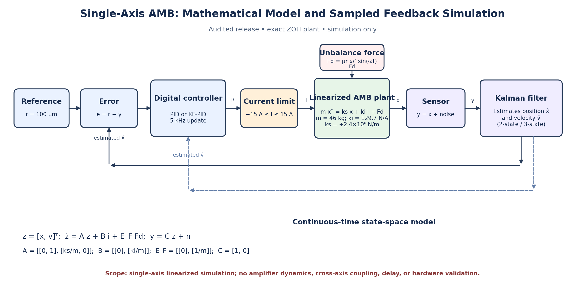

# Kalman Filter-Assisted PID Control for an Active Magnetic Bearing

A MATLAB-based simulation study investigating PID and Kalman-filter-assisted
control for a single-axis Active Magnetic Bearing (AMB).

## Project Overview

Active Magnetic Bearings use electromagnetic forces to support a rotor without
mechanical contact. Their open-loop instability makes feedback control essential.

This project compares conventional PID control with optimized PID and
two-state and three-state Kalman-filter-assisted PID controllers.

## System Architecture

## Mathematical Model

The linearized plant is represented by:

\[
m\ddot{x} = k_s x + k_i i + F_d
\]

Parameters:

| Parameter | Value |
|---|---:|
| Equivalent rotor mass | 46 kg |
| Force/current coefficient | 129.7 N/A |
| Destabilizing stiffness magnitude | 2.4 × 10⁶ N/m |
| Reference displacement | 100 µm |
| Controller sampling frequency | 5 kHz |
| Current limit | ±15 A |

The plant is discretized using an exact zero-order-hold method.

## Controllers Evaluated

- Baseline PID
- Optimized PID
- Two-state Kalman-filter-assisted PID
- Three-state Kalman-filter-assisted PID

## Robustness Studies

The MATLAB implementation includes studies of:

- Sensor measurement noise
- Plant parameter mismatch
- Rotor speed variations
- Tracking performance and control effort

## Repository Structure

- MATLAB scripts: controller implementation and simulation
- CSV files: controller comparison and robustness-study data
- MAT file: saved MATLAB workspace and result tables
- PNG/SVG: system architecture diagram
- Documentation: mathematical model and verification notes

## Limitations

This is a single-axis linearized simulation, not a physical hardware implementation.

Amplifier dynamics, cross-axis coupling, computation delays, and hardware
validation are outside the current model scope.

## Execution Status

The V7 source has undergone static and independent numerical checks, but the
full MATLAB optimization has not yet been independently executed and verified
in the reported environment. Treat the V7 CSV outputs as results requiring
runtime verification until the script has been run and checked.

## Tools

MATLAB, control systems, PID control, Kalman filtering, state-space modelling,
numerical simulation.
